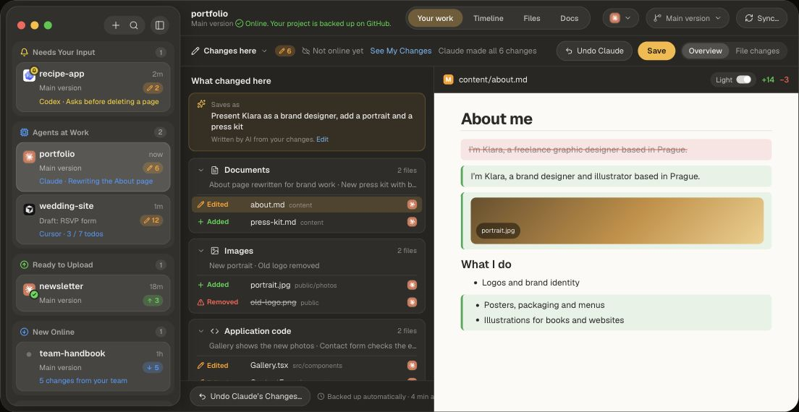

<picture>
  <source media="(prefers-color-scheme: dark)" srcset=".github/assets/banner-dark.svg">
  
</picture>

  

  
  
  

BeePot is a Mac app for reviewing work across projects built with coding agents. See which agent
is working where, inspect changed files, and check what Sync will upload. Choose Bee for
plain-language controls or Beekeeper for staging, commits and branches.

   
  Bee mode interface illustration. Example projects.

## Review work across projects

Keep your projects in one sidebar, grouped by agent activity and work that needs attention.
See when Claude Code, Codex, Cursor or another agent is working or waiting for an answer.
BeePot can notify you when an agent finishes or needs you, and offers projects it finds from
local agent activity.

Open a project to inspect changed files and read a summary. Markdown renders as a document;
images appear as pictures. Enable UI previews to compare supported SwiftUI and Jetpack Compose
screens using your project's build tools. Web previews open the page in BeePot; explicitly
connected development servers show a live page rather than a captured before-and-after comparison.

## Save versions and check what gets shared

In Bee, read the suggested description or write your own, then save a version. Sync shows its
planned steps before saving changes, bringing in remote updates and uploading your versions.
Put Online can create a private GitHub repository. Website deployment stays with your hosting service.

Bee warns about files such as `.env` and private keys before saving, so you can choose what stays
on this Mac. AI descriptions and commit messages use an installed Claude Code, Codex, Cursor,
OpenCode or Pi CLI through your own provider account.

## Recover earlier work

Automatic backups are on by default. BeePot takes recovery points when an agent starts, before
Sync, before switching drafts and every 15 minutes while your work changes. Periodic backups
pause in Low Power Mode. Ignored files and large untracked files are excluded.

Restore a recovery point to return the project to that earlier state. BeePot backs up the work
you are replacing first. Recovery points stay on this Mac, are thinned after a day and expire
after 14 days. Saved versions remain in Git history.

## Choose your controls

| | Bee | Beekeeper |
| --- | --- | --- |
| Reviewing | Grouped changes and plain-language summaries | Staged and unstaged files with code diffs |
| Saving and sharing | Save versions and preview Sync | Stage, commit, push, pull and amend |
| Working on alternatives | Drafts | Branches, linked worktrees and stashes |

Choose a mode in setup and switch in Settings. Both modes show agent activity and support
automatic backups. Press **⌘K** for projects and actions, or **Shift twice** to search files and
text in the current project.

## Install

1. Download **[BeePot.zip](https://github.com/MateeDevs/BeePot/releases/latest/download/BeePot.zip)**.
2. Unzip it and move **BeePot** to **Applications**.
3. Open BeePot, choose how you work, then add a project or pick one found from your agents' activity.

Requires **macOS 26 Tahoe or later**, on Apple silicon or Intel. GitHub sign-in and any missing
developer tools are handled when the relevant feature needs them.

Updates download automatically by default and install when you quit, or when you choose
**Restart** after a download. Updates are signed and verified. Preferences are in Settings;
**Check for Updates…** is in the BeePot menu.

See [Releases](https://github.com/MateeDevs/BeePot/releases) for versions and release notes.

## Privacy

Your project list, settings and recovery points are stored locally. Project discovery reads local
agent session information to find folders; that discovery data stays on your Mac.

Git connects to your configured remotes. GitHub features communicate with GitHub. Background fetch
checks remotes every five minutes by default, and BeePot automatically checks for application
updates. These preferences can be changed in Settings. Projects on a server use SSH.

AI summaries and commit messages pass the change content needed for the request to your selected
coding agent. Its provider processes the request through your account, under that provider's data
settings and policies. Automatic message preparation can be turned off in Settings.

BeePot does not include analytics or tracking. A BeePot account is not required.

## FAQ

<b>Does BeePot change my files?</b>

 
Saving, syncing, restoring and the built-in editor can change your project. Preview builds run
from BeePot's separate copy. Automatic recovery points are stored locally and do not upload your work.

<b>Which coding agents does it work with?</b>

 
BeePot detects Claude Code, Codex, Pi, Cursor Agent, Gemini CLI, OpenCode, Aider, Amp, GitHub Copilot,
Goose and Zed. AI summaries and commit messages use Claude Code, Codex, Cursor, OpenCode or Pi.

<b>Can I restore only one agent's edits?</b>

 
The agent undo action restores the project to the recovery point from before that agent started.
It does not separate overlapping edits made by several people or agents. You review the affected
files before restoring, and BeePot keeps a backup of the current work.

<b>How do I uninstall it?</b>

 
Quit BeePot and move it from <b>Applications</b> to the Trash. Your project folders stay in place.
BeePot's settings and project list live in <code>~/Library/Application Support/BeePot</code>.

## Feedback

BeePot is in beta. [Report a bug](https://github.com/MateeDevs/BeePot/issues/new/choose) or
[start a discussion](https://github.com/MateeDevs/BeePot/discussions) for ideas and questions.
Both are also available in the app's Help menu. For private feedback, email
[info@matee.cz](mailto:info@matee.cz).

   
  Made with 🍯 by <a href="https://www.matee.cz">Matee</a>

